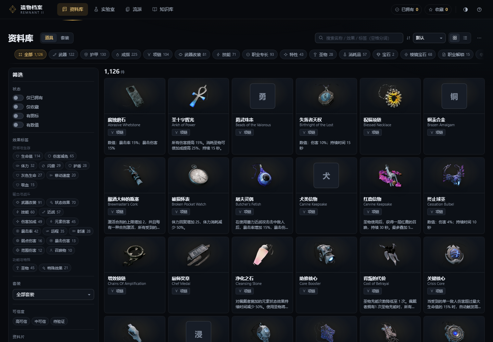
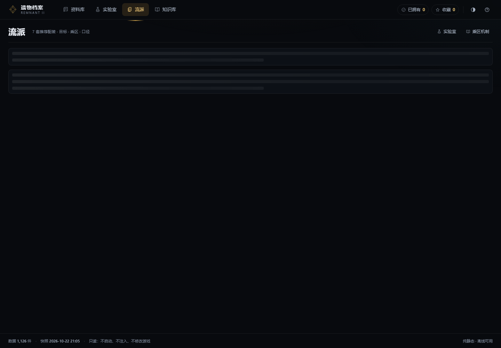
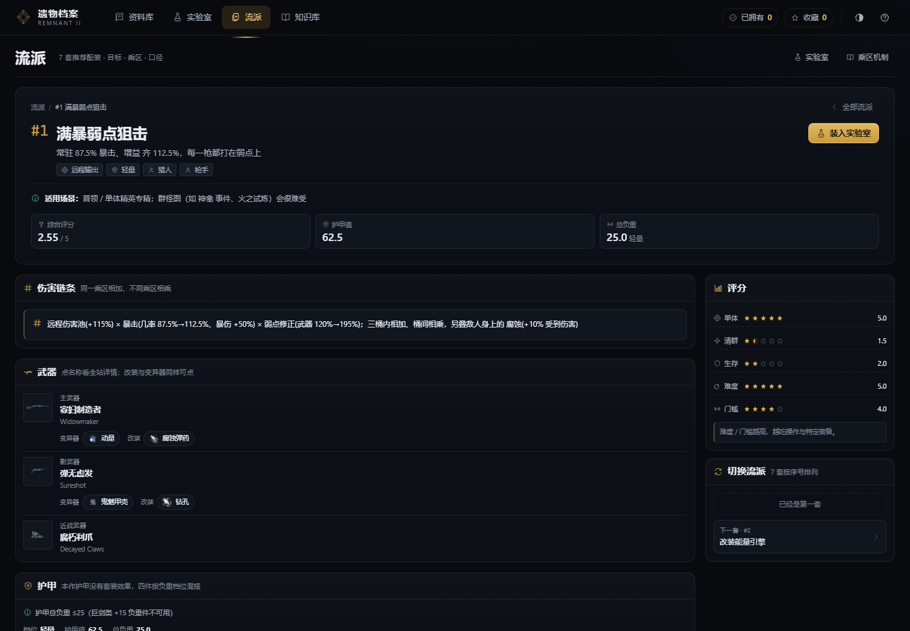
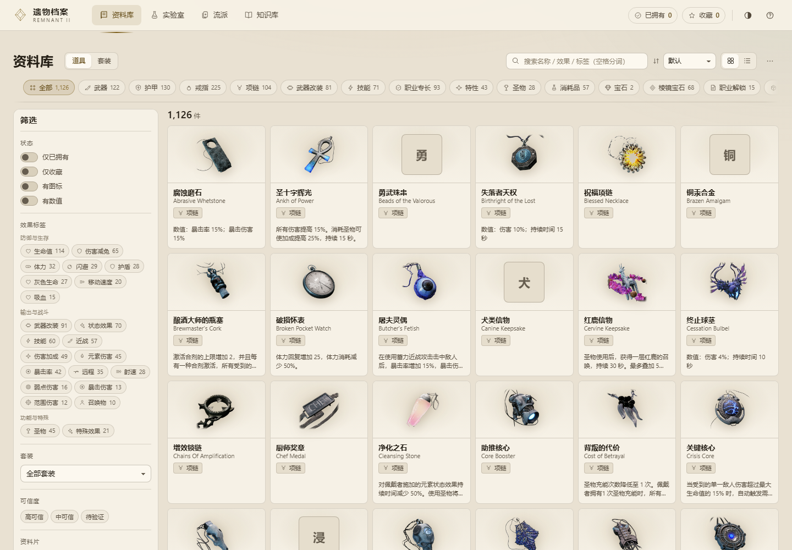
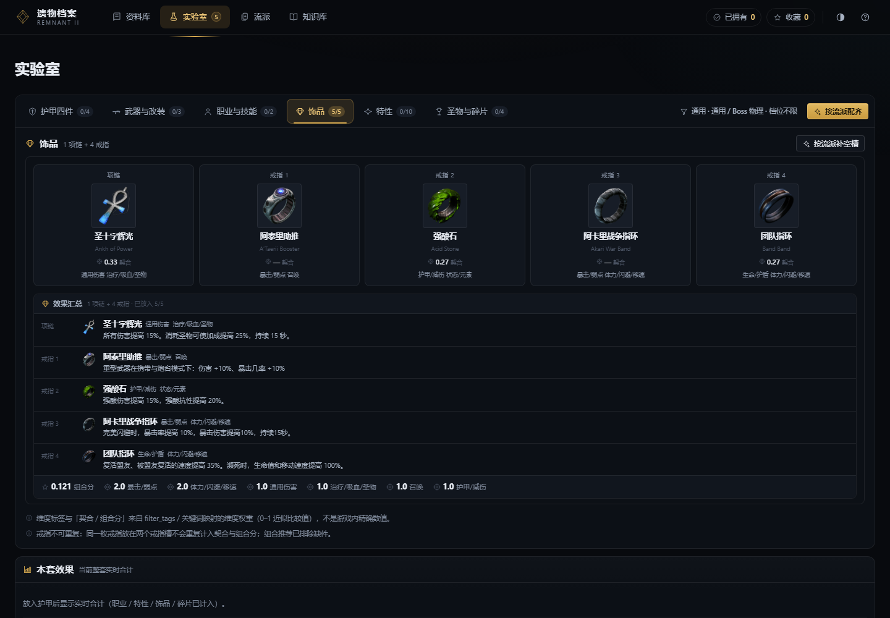

# 遗物档案 · RELIC ARCHIVE

> 《遗迹2》（Remnant II）**本地离线数据库 + 配装工作台 + 流派图鉴 + 机制知识库**。
> 纯静态、无构建步骤、无 CDN、无外部字体、无联网请求；数据与图标全部随仓库分发。
> 全程**只读游戏**：不启动、不注入、不读内存、不改存档或 pak。

**四个领域**

| 领域 | 路由 | 一句话 |
|---|---|---|
| 资料库 | `#/items` | 1126 件真道具：图标网格、中文效果句、数值、套装、获取途径，任意入口点开同一个详情 |
| 实验室 | `#/lab` | 15 槽工作台 + 实时合计 + 推荐/逐槽替换/档位对照/计算器/存档导出 |
| 流派 | `#/builds` | 7 套成型的推荐配装：评分、伤害链条、装备拆解、输出循环、替换方案、清群诊断 |
| 知识库 | `#/codex` | 13 篇机制条目：护甲减伤公式、伤害乘区、暴击/弱点、负重与闪避、状态效果、证据边界 |

界面提供**黑夜 / 白天两套主题**（默认跟随系统），顶栏按钮或 `Alt+T` 切换，偏好持久化。



---

## 快速开始

需要 Python 3.10+（只用标准库），无需 Node、无需 npm install、无构建步骤。

```bash
cd relic-archive
python serve.py                 # → http://127.0.0.1:8777/
python serve.py --port 8780     # 换端口
python serve.py --open          # 启动后自动开浏览器
```

Windows 也可以双击 `start.cmd`。

> ⚠️ 必须通过本地服务器访问：`file://` 下浏览器会拦截 ES module 与 `fetch`。
> 部署到静态托管（GitHub Pages / Netlify / 任意 Nginx）同样可用，把整个目录作为站点根即可；
> 数据与图标均使用**相对路径**（`./data/*`、`./assets/*`），所以既能部署在域名根路径，
> 也能部署在子路径（如 `https://<user>.github.io/relic-archive/`）。
> 在线版本：**https://stollor.github.io/relic-archive/**。

---

## 截图

| 流派列表（黑夜） | 流派详情（黑夜） |
|---|---|
|  |  |

| 资料库（白天） | 实验室（黑夜） |
|---|---|
|  |  |

更多：`docs/screenshots/`（含知识库、流派白天、移动端 390）。

---

## 四个领域能做什么

### 资料库 `#/items`

- 1126 件真道具（共 1894 条记录，含非道具资产）：分类 / 槽位 / 套装 / 数值区间 / 游戏标签筛选，关键词搜索命中名称·效果·描述·标签。
- 详情（桌面居中弹窗、移动全屏抽屉）：大图、中英文名、**官方效果句**、数值明细、套装、获取途径、背景故事、数据来源与可信度。
- 43 套护甲聚合视图（`#/items/sets`），一键整套装入实验室。
- 视图密度（网格 / 列表）、名称语言、排序；深链可分享复现。

### 实验室 `#/lab`

- 15 槽工作台：主/副武器、近战、头盔/胸甲/腿甲/手套、项链、4 枚戒指、圣物、主/副职业。
- 实时合计（防御 / 生存 / 机动）：护甲、护甲减伤、五类抗性、总减伤、最坏减伤、EHP、负重档位、体力与闪避帧。
- 面板：配装推荐（基于当前设置的 top 候选 + 6 种排序）、逐槽替换、档位对照、护甲/减伤计算器、存档导出（含给 AI 的结构化提示词）。

### 流派 `#/builds`

- 7 套成型配装：满暴弱点狙击 / 改装能量引擎 / 改装速切·星辰穿刺 / 状态效果持续伤害流 / 吸血·回复生存流 / 黑巨剑·蓄力爆发流 / 双召·伙伴齐射流。
- 列表页：按目标选（单体 / 清群 / 生存 / 易上手 / 低门槛 / 综合）、5 项星级评分、横向对比表、8 条配装规则。
- 详情页：伤害链条、武器（固有改装/变异器/改装）、护甲四件混搭逐件数值、饰品、职业与天赋、装配说明、输出循环、替换方案、清群诊断、难点、饰品乘区、口径与证据。
- 道具 chip 打开全站统一详情；**「装入实验室」**一键把可解析的 15 槽写入工作台。

### 知识库 `#/codex`

- 13 篇机制条目，带公式、表格、证据与来源边界；无来源标注「待验证」，不编造。

---

## 亮 / 暗双主题

| | 黑夜「黑曜石 · 烬火」（默认） | 白天「荒原白昼」 |
|---|---|---|
| 表面 | `#080a0e` → `#1e2530` 分层 | `#e9e1d2` 羊皮纸 / `#f6f1e6` 卡片 / `#e6decd` 按压 |
| 文字 | `#e9edf4 / #a7b2c2 / #808b9c` | `#241e15 / #52483a / #665d4f` |
| 强调 | 黄铜金 `#d9ac51`·`#f0c979`、青瓷 `#5bbcc6`、烬红 `#d75b50`、苔绿 `#63a86e` | 深铜 `#7a5c17`、金块反白 `#fbf4e2`、青瓷 `#276b73`、锈红 `#a83a31` |
| 阴影 | 深黑投影 + 金色微光 | 暖色轻投影 + 实描边 |

- 唯一色值来源：`css/tokens.css`（`:root` 暗色 + `html[data-theme="light"]` 整套覆盖）；`css/tokens.css` 之外 **0 处颜色字面量**。
- 首屏 `js/theme-boot.js` 在样式表之前落 `data-theme`，不闪白/不闪黑；`js/core/theme.js` 管三态循环、`Alt+T`、系统偏好监听、`theme-color` 同步。
- 偏好存 `localStorage["r2.v2.ui"].theme`（`auto｜light｜dark`，默认 `auto`）。
- 对比度：130 组 WCAG AA 组合全部通过（`node qa/theme-contrast.mjs`）。

---

## 目录结构

```
relic-archive/
├─ index.html                 入口：顶栏四领域 + 主题钮 + 视图容器 + 浮层宿主
├─ lab.html                   旧链接跳转页 → index.html#/lab（配色跟随系统）
├─ serve.py                   本地静态服务器（标准库；/、/data/*、/assets/*、/api/health）
├─ start.cmd                  Windows 一键启动
├─ favicon.svg
├─ css/
│  ├─ tokens.css              设计变量唯一来源（暗/亮两套）
│  ├─ base.css                重置 / 排版 / 外壳（顶栏 / 领域切换 / 页脚）
│  ├─ components.css          全站组件（按钮/卡/槽/表/抽屉/弹窗/详情/Toast…）
│  ├─ components-picker.css   装备选择器
│  └─ view-{library,lab,builds,codex}.css   视图级样式（只允许 token）
├─ js/
│  ├─ main.js                 启动、路由派发、视图生命周期、错误边界
│  ├─ theme-boot.js           首屏主题引导（CSS 之前同步执行）
│  ├─ core/{dom,icons,labels,store,api,ui,router,theme}.js
│  ├─ components/{item-card,item-detail,picker}.js
│  └─ views/{library,lab,builds,codex}.js + lab/*
├─ data/                      运行时数据（站点的唯一数据源，随仓库分发）
│  ├─ items.json              1894 条道具主数据（1126 真道具）
│  ├─ builds.json             流派 7 套
│  ├─ site_data.json          实验室数据（护甲/饰品/预设/矩阵）
│  ├─ archetypes.json / terms.json / acq.json / item_effects.json
│  ├─ codex/index.json        知识库 13 篇
│  ├─ icon_index.json         图标索引
│  └─ README.md               数据字典
├─ assets/icons/*.png         1004 张图标（256px RGBA）
├─ docs/
│  ├─ UX_SPEC.md              IA / 交互 / 组件 / 术语 / 视觉 / 验收契约（改页面前必读）
│  ├─ DATA.md                 数据来源、schema、快照与再生
│  └─ screenshots/            README 与发布用截图
├─ pipeline/                  数据生成与同步（开发用，见 pipeline/README.md）
│  ├─ mk_builds_json.py       data/builds.json 生成器（可 --check 校验引用）
│  ├─ sync-data.py            从 .mimocode 工作区同步快照（开发机用）
│  └─ _source/                配装源数据快照
└─ qa/                        独立验收（零依赖 Chrome CDP）
   ├─ shot.js                 截图 + console/HTTP/4xx 门禁（--theme dark|light）
   ├─ interactions.js         67 项真实交互（鼠标/键盘/移动端/主题）
   ├─ audit.py                静态审计（硬编码色 / 裸英文 / 重复标题 / a11y）
   ├─ theme-contrast.mjs      双主题 token 对比度（WCAG AA）
   ├─ REPORT.md               最近一轮验收报告
   ├─ results/                自动化结果 JSON
   └─ shots/                  本地截图（.gitignore，可随时重跑生成）
```

---

## 验收（一条命令跑完）

```bash
python serve.py &                       # 终端 A
node qa/shot.js --theme dark            # 54 项截图 + console/HTTP 门禁
node qa/shot.js --theme light           # 同上，亮色
node qa/interactions.js                 # 67 项交互（含流派 7 项、主题 3 态、移动端）
python qa/audit.py                      # 静态审计
node qa/theme-contrast.mjs              # 双主题对比度
```

最近一轮（2026-10-28）结果：**shot 54/54 × 2、interactions 67/67、audit 0 FAIL、contrast 130/130**。
详见 [`qa/REPORT.md`](qa/REPORT.md)。

---

## 开发约定

- **无构建步骤**：原生 ES module + 原生 CSS，改完刷新即可，不引入打包器与 npm 依赖。
- **颜色只来自 `css/tokens.css`**；新增主题色要在 `:root` 与 `html[data-theme="light"]` 成对给值，并跑对比度脚本。
- **组件唯一**：详情、抽屉、弹窗、Toast、选择器、状态存储都在 `js/components`、`js/core`，视图禁止各自实现。
- **契约先行**：改 IA / 交互 / 视觉前先读 [`docs/UX_SPEC.md`](docs/UX_SPEC.md)。
- 视图中禁止直接 `fetch`，数据一律经 `js/core/api.js`；本地状态一律经 `js/core/store.js`。
- 中文优先：用户可见文案简体中文；英文只允许道具英文名副标题、证据/原文折叠区、代码标识符。

---

## 数据来源与免责

- 数据来自**本机《遗迹2》游戏文件的离线解包**（UE5 IoStore，`retoc` 只读抽取）+ [remnant2.wiki.gg](https://remnant2.wiki.gg/) 公开文本整理；官方中文取自游戏 locres。
- 数值/评分口径：护甲减伤 `A/(A+200)`、抗性点数为该类型 %DR、总减伤上限 80%；配装评分是对「该套实际手段」的 1–5 评估，**不是游戏内精确伤害公式**（页面内均标注口径）。
- 本项目为**非官方**玩家资料站，与 Gunfire Games / Gearbox 无关；《遗迹2》及其素材版权归原权利人所有。数据仅用于个人学习与查询，请勿商用。
- 只读声明：不启动游戏、不注入 UE4SS、不读游戏内存、不修改存档或 pak。
- 上游解包/配装工具链（数 GB 原始资产与解析脚本）不包含在本仓库；本仓库只保留跑动站点所需的最小数据集与配装合并脚本（见 [`docs/DATA.md`](docs/DATA.md)、[`pipeline/README.md`](pipeline/README.md)）。
